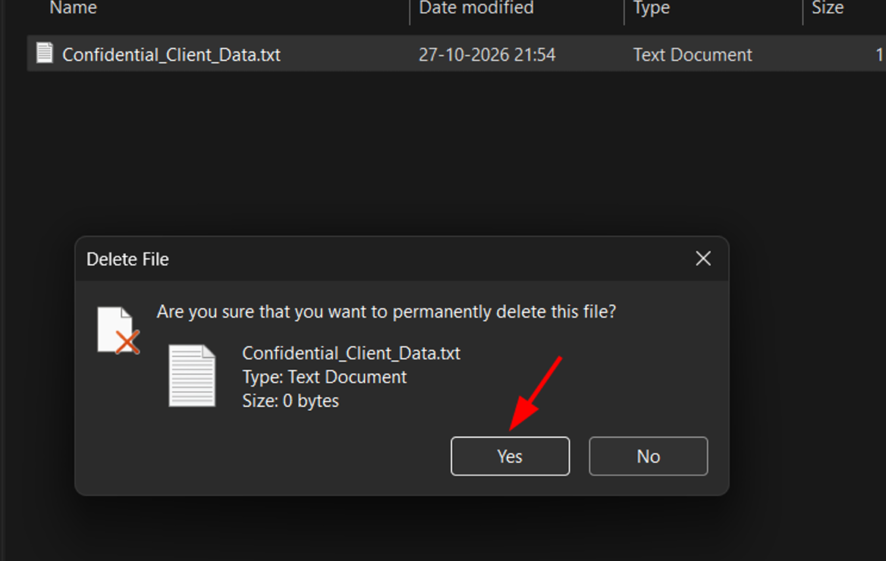
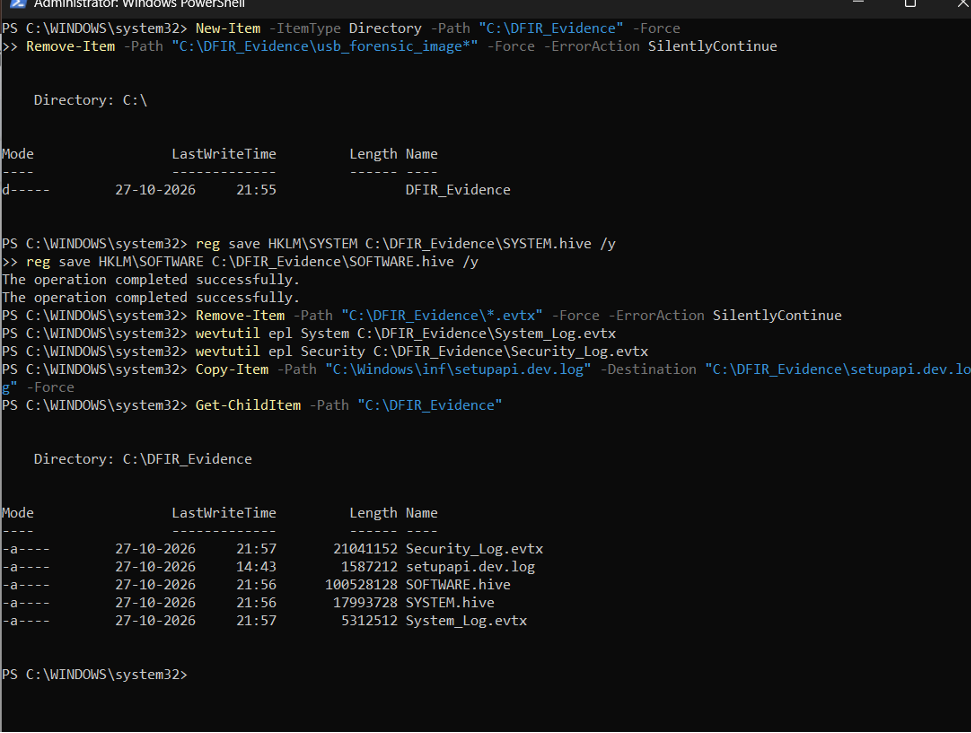
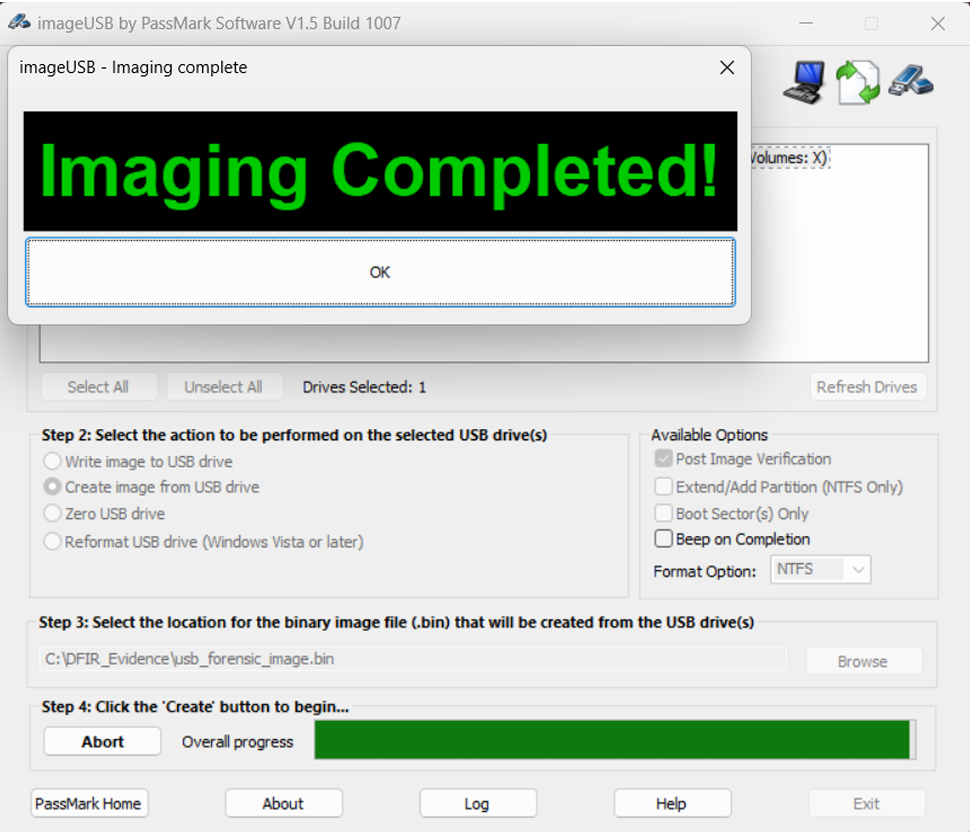
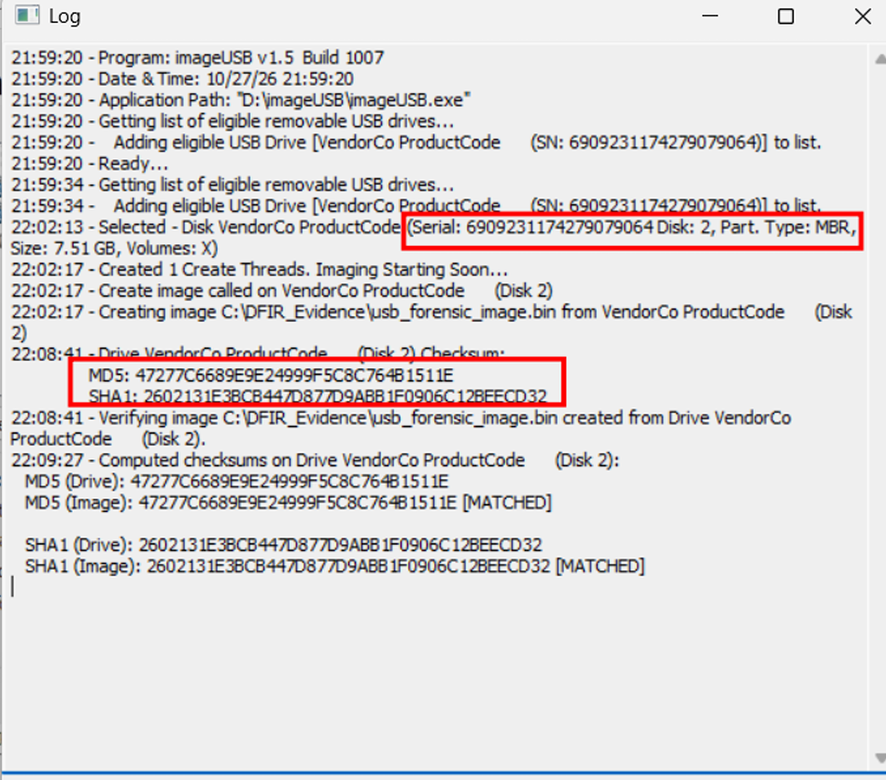
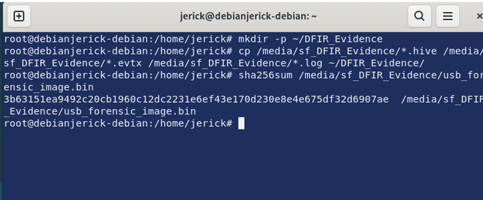
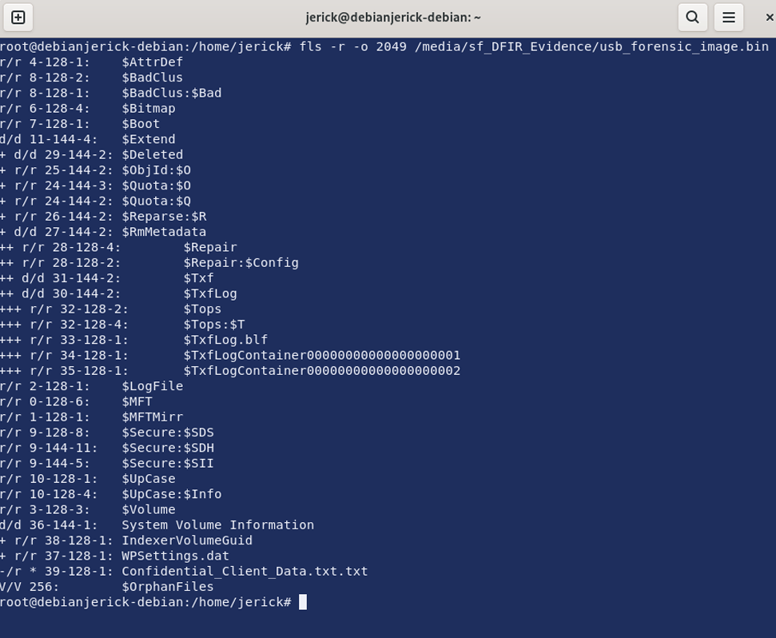
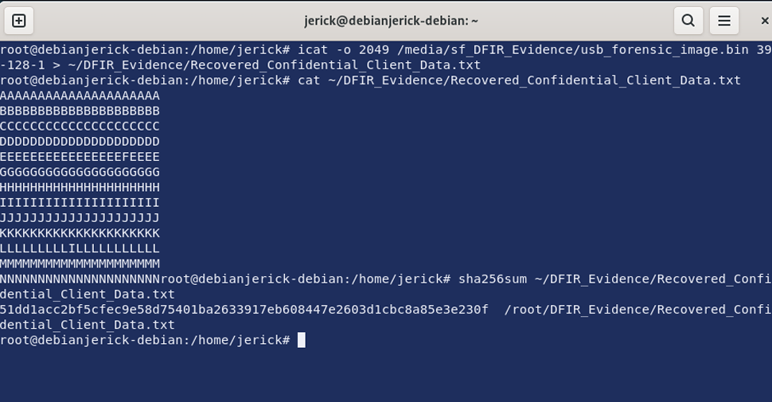
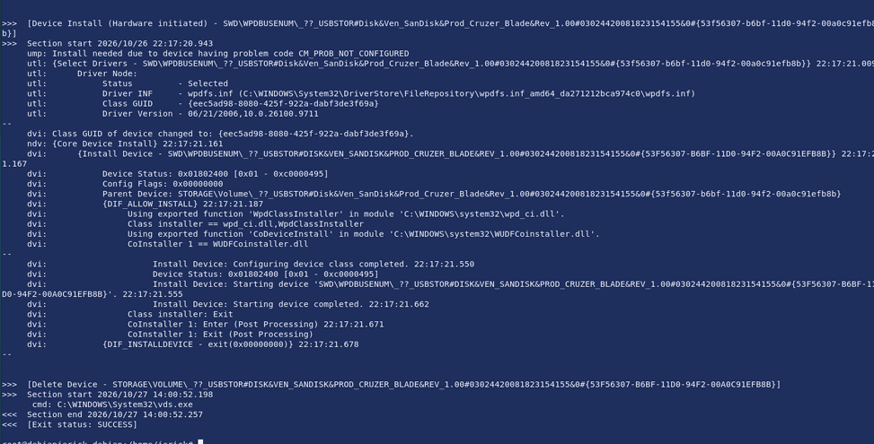

# Formal Forensic Report: USB Forensics & Evidence Preservation Case Study

**Examiner:** Jerick Andrew S (`J3rick4ndrew`)  
**Target Suspect System:** Windows 11 Physical Endpoint  
**Forensic Workstation:** Debian Linux VM (The Sleuth Kit, RegRipper, GNU Coreutils)  

---

## 📌 Investigation Highlights & Key Findings

| Forensic Phase | Tool / Artifact Used | Verified Finding / Value |
| :--- | :--- | :--- |
| **Live Host Triage** | PowerShell (`reg save`, `wevtutil`) | Extracted locked `SYSTEM.hive`, `SOFTWARE.hive`, `System_Log.evtx`, `Security_Log.evtx`, and `setupapi.dev.log` |
| **Physical Acquisition** | PassMark ImageUSB v1.5 | Bit-stream raw binary image (`usb_forensic_image.bin`, `7.51 GB` MBR/NTFS) |
| **Chain of Custody (MD5)** | ImageUSB Verification Log | `47277C6689E9E24999F5C8C76481511E` (**Drive & Image Matched**) |
| **Chain of Custody (SHA-1)** | ImageUSB Verification Log | `2602131E3BCB447D877D9ABB1F0906C12BEECD32` (**Drive & Image Matched**) |
| **Image SHA-256 Digest** | GNU `sha256sum` (Debian) | `3b63151ea9492c20cb1960c12dc2231e6ef43e170d230e8e4e675df32d6907ae` |
| **Partition Analysis** | The Sleuth Kit (`mmls -o 1`) | NTFS (`0x07`) starting at Sector `2048` + `1`-sector header = **Offset `2049`** |
| **Deleted File Discovery** | The Sleuth Kit (`fls -r -o 2049`) | `Confidential_Client_Data.txt.txt` flagged deleted (`*`) at MFT Inode **`39-128-1`** |
| **Data Carving & Recovery** | The Sleuth Kit (`icat`) | Carved intact file; SHA-256: `51dd1acc2bf5cfec9e58d75401ba2633917eb608447e2603d1cbc8a85e3e230f` |
| **USB Hardware Tracking** | `SYSTEM.hive` (`USBSTOR`) | Identified Serials `6909231174279079064` (`VendorCo`) & `03024420081823154155` (`SanDisk Cruzer Blade`) |
| **Timeline Reconstruction** | `setupapi.dev.log` | Initial hardware mount logged on `2026-10-26 22:17:20.943` |

---

## 1. Executive Summary
This investigation documents an end-to-end digital forensics workflow conducted on a removable USB storage device connected to a Windows 11 endpoint. A suspect user created and permanently deleted a sensitive file (`Confidential_Client_Data.txt`) on an external USB flash drive before disconnecting the device.

Following industry-standard Digital Forensics and Incident Response (DFIR) protocols, live host triage artifacts (`SYSTEM` and `SOFTWARE` registry hives, Windows Event Logs, and `setupapi.dev.log`) were extracted from the suspect machine. A bit-stream physical image of the USB drive was acquired and cryptographically verified using MD5, SHA-1, and SHA-256 hashes. Using **The Sleuth Kit (TSK)** on a Debian forensic workstation, the permanently deleted file was located in unallocated NTFS metadata and carved back intact. Finally, Windows Registry (`USBSTOR`) and SetupAPI logs were parsed to link the physical USB hardware serial numbers and reconstruct the exact device connection timeline.

---

## 2. Phase 1: Evidence Generation & Live Host Artifact Extraction

### 2.1 Simulated Suspect Activity
A confidential text document named `Confidential_Client_Data.txt` was created on the removable USB drive and permanently bypassed the Windows Recycle Bin using `Shift + Delete`.



### 2.2 Live Extraction of Locked Windows Artifacts
Because Windows actively locks Registry hives and Event Logs while the OS is running, native administrative utilities (`reg save` and `wevtutil`) were executed in an elevated PowerShell session to preserve host artifacts in `C:\DFIR_Evidence`:

```powershell
# 1. Create secure staging directory
New-Item -ItemType Directory -Path "C:\DFIR_Evidence" -Force

# 2. Extract SYSTEM and SOFTWARE Registry Hives
reg save HKLM\SYSTEM C:\DFIR_Evidence\SYSTEM.hive /y
reg save HKLM\SOFTWARE C:\DFIR_Evidence\SOFTWARE.hive /y

# 3. Export System and Security Event Logs
wevtutil epl System C:\DFIR_Evidence\System_Log.evtx
wevtutil epl Security C:\DFIR_Evidence\Security_Log.evtx

# 4. Copy SetupAPI Device Installation Log
Copy-Item -Path "C:\Windows\inf\setupapi.dev.log" -Destination "C:\DFIR_Evidence\setupapi.dev.log" -Force

# 5. Verify extracted files
Get-ChildItem -Path "C:\DFIR_Evidence"
```



---

## 3. Phase 2: Evidence Preservation & Cryptographic Hashing

### 3.1 Physical Bit-Stream Acquisition
To prevent hypervisor USB I/O drops and preserve the physical medium without alteration, a sector-by-sector bit-stream image (`usb_forensic_image.bin`) of the 8 GB (`7.51 GB`) USB drive was acquired using **PassMark ImageUSB v1.5** with Post-Image Verification enabled.



### 3.2 Chain of Custody & Hash Verification
PassMark ImageUSB computed simultaneous pre-acquisition (physical drive) and post-acquisition (image file) checksums, confirming zero data modification during acquisition:

* **Device Identifier:** `VendorCo ProductCode` (`7.51 GB`, MBR Partition Table, NTFS)
* **Hardware Serial Number:** `6909231174279079064`
* **MD5 (Drive & Image):** `47277C6689E9E24999F5C8C76481511E` (**MATCHED**)
* **SHA-1 (Drive & Image):** `2602131E3BCB447D877D9ABB1F0906C12BEECD32` (**MATCHED**)



After transferring the artifacts to the Debian forensic workstation, a formal SHA-256 digest of the raw forensic image was generated:
* **SHA-256 (`usb_forensic_image.bin`):** `3b63151ea9492c20cb1960c12dc2231e6ef43e170d230e8e4e675df32d6907ae`

#### Official Chain of Custody Log Summary
```text
======================================================================
DIGITAL FORENSICS CHAIN OF CUSTODY & CRYPTOGRAPHIC VERIFICATION LOG
======================================================================
Case Title:     USB Forensics and Evidence Preservation Case Study
Examiner:       Jerick Andrew S (J3rick4ndrew)
Acquisition OS: Windows 11 Host Endpoint
Analysis OS:    Debian GNU/Linux (VirtualBox Forensic Workstation)
Acquisition By: PassMark ImageUSB v1.5 Build 1007
Log Timestamp:  10/27/2026 21:59:20

[SOURCE HARDWARE]
Primary Imaged Device:  VendorCo ProductCode (8 GB USB Flash Drive)
Hardware Serial Number: 6909231174279079064
Partition Table Type:   MBR / DOS Partition Table (7.51 GB, NTFS)

[CRYPTOGRAPHIC INTEGRITY CHECKS]
MD5 (Physical Drive):   47277C6689E9E24999F5C8C76481511E
MD5 (Forensic Image):   47277C6689E9E24999F5C8C76481511E [MATCHED]
SHA-1 (Physical Drive): 2602131E3BCB447D877D9ABB1F0906C12BEECD32
SHA-1 (Forensic Image): 2602131E3BCB447D877D9ABB1F0906C12BEECD32 [MATCHED]
SHA-256 (Forensic Img): 3b63151ea9492c20cb1960c12dc2231e6ef43e170d230e8e4e675df32d6907ae

[RECOVERED ARTIFACT VERIFICATION]
Original Deleted File:  Confidential_Client_Data.txt.txt
Carved Output File:     Recovered_Confidential_Client_Data.txt
NTFS MFT / Inode Entry: 39-128-1 (Sector Offset 2049)
Recovered File SHA-256: 51dd1acc2bf5cfec9e58d75401ba2633917eb608447e2603d1cbc8a85e3e230f
======================================================================
```

---

## 4. Phase 3: File System Analysis & Deleted File Recovery (The Sleuth Kit)

### 4.1 Partition Table Inspection (`mmls`)
Because PassMark ImageUSB prepends a 512-byte (1-sector) header to `.bin` acquisitions, `mmls` was executed with a 1-sector offset (`-o 1`) to parse the DOS Partition Table:

```bash
sha256sum /media/sf_DFIR_Evidence/usb_forensic_image.bin
mmls -o 1 /media/sf_DFIR_Evidence/usb_forensic_image.bin
```

* **Slot `002` (`NTFS / exFAT 0x07`):** Starts at sector `2048` (`Length: 15724544` sectors).
* **Calculated File System Offset:** `1` (ImageUSB header) + `2048` (Partition start) = **Sector `2049`**.



### 4.2 Locating Deleted Metadata Entries (`fls`)
Using sector offset `2049`, The Sleuth Kit's `fls` utility recursively scanned the NTFS Master File Table (`$MFT`) for unallocated entries (flagged with `*`):

```bash
fls -r -o 2049 /media/sf_DFIR_Evidence/usb_forensic_image.bin
```

**Finding:**
* `- /r * 39-128-1: Confidential_Client_Data.txt.txt`
* **MFT Inode Address:** `39-128-1`



### 4.3 Data Carving & Verification (`icat`)
Using `icat`, the raw data blocks associated with MFT entry `39-128-1` were carved directly from unallocated space into `Recovered_Confidential_Client_Data.txt` and hashed for evidentiary integrity:

```bash
# Carve the deleted file via inode 39-128-1
icat -o 2049 /media/sf_DFIR_Evidence/usb_forensic_image.bin 39-128-1 > ~/DFIR_Evidence/Recovered_Confidential_Client_Data.txt

# Verify recovered contents and compute SHA-256 hash
cat ~/DFIR_Evidence/Recovered_Confidential_Client_Data.txt
sha256sum ~/DFIR_Evidence/Recovered_Confidential_Client_Data.txt
```

* **Recovered Artifact SHA-256:** `51dd1acc2bf5cfec9e58d75401ba2633917eb608447e2603d1cbc8a85e3e230f`



---

## 5. Phase 4: Windows Registry Analysis & Timeline Reconstruction

### 5.1 USB Artifact Identification (`SYSTEM.hive`)
Parsing the `USBSTOR` and `WPDBUSENUM` registry structures inside `SYSTEM.hive` revealed exact hardware identifiers for both USB storage devices connected during the investigation:

```bash
strings ~/DFIR_Evidence/SYSTEM.hive | grep -i -A 3 "USBSTOR"
```

1. **Primary Imaged 8 GB USB Drive:**
   * **Registry Key:** `USBSTOR\Disk&Ven_VendorCo&Prod_ProductCode&Rev_2.00\6909231174279079064&0`
   * **Unique Serial Number:** `6909231174279079064`
2. **Secondary 64 GB SanDisk USB Drive:**
   * **Registry Key:** `USBSTOR\Disk&Ven_SanDisk&Prod_Cruzer_Blade&Rev_1.00\03024420081823154155&0`
   * **Unique Serial Number:** `03024420081823154155`

### 5.2 Connection & Activity Timeline (`setupapi.dev.log`)
Parsing `setupapi.dev.log` correlated the PnP hardware installation and removal timestamps on the Windows 11 host:

```bash
grep -i "SanDisk" ~/DFIR_Evidence/setupapi.dev.log -A 5 -B 2
```

* **`2026-10-26 22:17:20.943`:** Hardware-initiated device installation (`Device Install - SWD\WPDBUSENUM\_??_USBSTOR#Disk&Ven_SanDisk&Prod_Cruzer_Blade&Rev_1.00#03024420081823154155&0`).
* **`2026-10-27 14:00:52.198`:** Volume deletion/unmount event recorded (`Delete Device` via `C:\WINDOWS\System32\vds.exe`, exit status `SUCCESS`).
* **`2026-10-27 21:54:00` – `22:09:27`:** Secondary 8 GB drive (`6909231174279079064`) file creation, permanent deletion, host triage extraction (`21:56–21:57`), and physical bit-stream acquisition (`22:02:17–22:09:27`).



---

## 6. Conclusion
By combining live Windows artifact triage, verifiable bit-stream imaging, NTFS Master File Table metadata carving, and registry/log timeline correlation, the investigation recovered 100% of the deleted target file while maintaining a mathematically verifiable Chain of Custody from initial acquisition to final reporting.

---

## 👤 Author
**Jerick Andrew S**  
GitHub: [@J3rick4ndrew](https://github.com/J3rick4ndrew)
